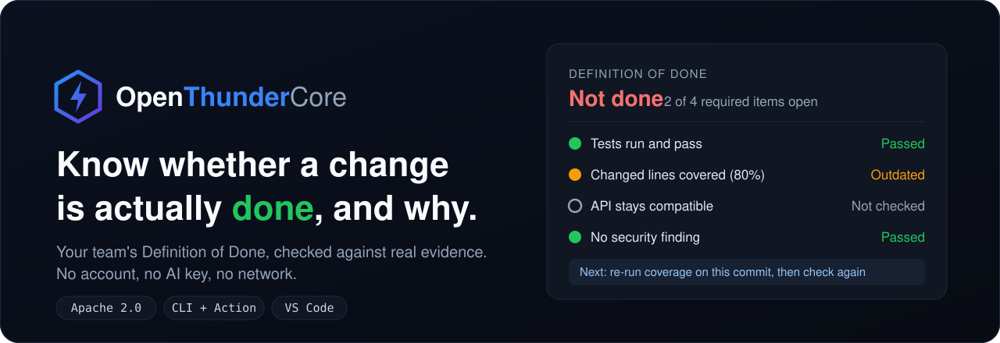
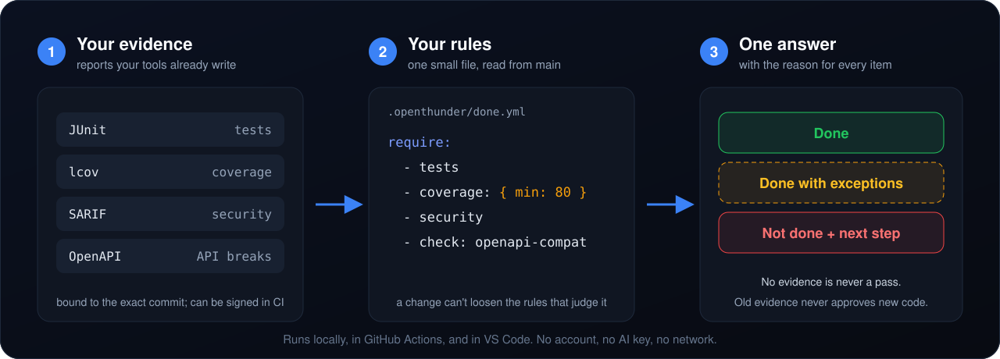

<p align="center">
  
</p>

<p align="center">
  <a href="LICENSE"></a>
  <a href="https://github.com/SkillsTechTalk/openthunder-core/actions/workflows/ci.yml"></a>
  
</p>

## How it works

<p align="center">
  
</p>

**In one line:** your tools write reports, your team writes the rules once, and OpenThunder Core tells you whether this
exact change meets them, item by item, with the evidence and the next step.

## Try it in a minute

```bash
git clone https://github.com/SkillsTechTalk/openthunder-core && cd openthunder-core
npm install && npm run build && npm install -g ./packages/core   # gives you the done-core command

cd your-repo
done-core init                                   # writes .openthunder/done.yml; commit it to main
done-core collect --format junit --report junit.xml
done-core collect --format lcov --report coverage/lcov.info --base main
done-core evaluate --base main
```

No repo handy? Run the demo: `examples/definition-of-done/demo.sh`.
In CI: [`packages/core/action/example-workflow.yml`](packages/core/action/example-workflow.yml).

## Why teams trust the answer

| Promise | What it means |
|---|---|
| **No evidence is never a pass** | Missing evidence is *Not checked*, and a required item that is Not checked keeps the change Not done. |
| **Old evidence never approves new code** | Results are bound to the exact commit. A report from older code is *Outdated*. |
| **Rules a change cannot loosen** | The policy is read from the branch you merge into, not from the change. An edit to it counts only once an approver the policy names signs off on that exact edit ([how](docs/FORMATS.md#changing-the-policy-done-policy-approval-v1)). |
| **Exceptions stay honest** | A named approver accepts a risk until a date, and the record still shows what the evidence said. |
| **Trusted CI evidence** | Receipts signed by your CI key count where the policy requires it; local results are labeled self-reported. |
| **Local and keyless** | It reads files and git. It never runs your code, and nothing leaves your machine. |

## What is in this repository

| Package | What it is |
|---|---|
| [`packages/core`](packages/core) | The evaluator, the evidence importers, the OpenAPI check, the `done-core` CLI, and a GitHub Action |
| [`packages/vscode`](packages/vscode) | **OpenThunder: Definition of Done** for VS Code, including a GitHub Copilot agent-mode tool |
| [`packages/core/conformance`](packages/core/conformance) | The reference behavior any implementation can run |

The file format is in [docs/FORMATS.md](docs/FORMATS.md).

## Open source, and what is not

This repository is Apache 2.0: use it, change it, ship it, including commercially. The official OpenThunder downloads
(Desktop, the Marketplace extension) are free, build on this code, and add proprietary analyzers as clearly labeled
plugins that write evidence this core reads. Team and Enterprise features are a paid service.
See [docs/BOUNDARY.md](docs/BOUNDARY.md).

## Contributing

Contributions are welcome under the Developer Certificate of Origin: sign off each commit (`git commit -s`).
See [CONTRIBUTING.md](CONTRIBUTING.md). Security reports: [SECURITY.md](SECURITY.md).

OpenThunder™ is a trademark of Skills Tech Talk, LLC; see [TRADEMARKS.md](TRADEMARKS.md).
